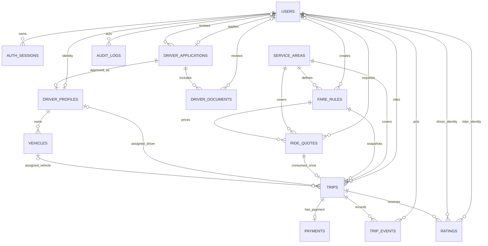

# Relasi database — MVP

ERD berikut merangkum relasi pada migrations hingga [`20261028000100_email_otp.sql`](../migrations/20261028000100_email_otp.sql). `||` = satu, `o|` = opsional satu, `o{` = banyak.

## Hubungan penting

- Login memakai `users.email_normalized` yang unik dan `email_verified_at`; `phone_e164` kini opsional dan tidak dipakai untuk autentikasi.
- Sebelum akun dibuat, OTP email disimpan sebagai challenge di `auth_otp_challenges`, berisi `email_normalized`, `code_hash`, status, attempt count, expiry, dan resend cooldown. Challenge menyimpan email, bukan FK ke `users`, agar email baru dapat diverifikasi sebelum membuat akun.
- `users` adalah identitas akun; role disimpan sebagai enum `users.role` (satu role per akun pada MVP). Pengguna dapat menjadi penumpang dan, setelah persetujuan, memiliki `driver_profile`.
- Setiap pengguna memiliki paling banyak satu `driver_application`. Aplikasi menyimpan banyak metadata dokumen dan dapat menghasilkan satu profil driver untuk pengguna yang sama.
- Setiap driver profile dapat memiliki banyak kendaraan. Composite FK trip memastikan kendaraan yang ditugaskan benar-benar milik driver itu dan sesuai tipe kendaraan.
- Area layanan memiliki aturan tarif berversi. Quote dan trip mengikat area, tipe kendaraan, mata uang, dan fare rule yang sama.
- Satu quote hanya dapat dikonsumsi satu trip. Composite FK juga memastikan rider dan snapshot tarif trip cocok dengan quote.
- `UNIQUE (rider_id, idempotency_key)` mencegah booking ganda saat retry. Klaim driver bersamaan tetap memerlukan transaksi/conditional update di aplikasi.
- Trip memiliki banyak status event, maksimal satu payment, dan maksimal satu rating per arah (`rider_to_driver` / `driver_to_rider`). Rating menyimpan pasangan peserta dari trip.
- PostGIS menyimpan batas area serta titik pickup/destination historis. Lokasi driver live berada di Redis dengan TTL, bukan di tabel PostgreSQL.
- `ON DELETE RESTRICT` melindungi histori perjalanan. Session dapat ikut terhapus bersama akun; referensi aktor audit dapat menjadi null.
- Support, notifikasi, pembayaran non-tunai, dan lokasi driver persisten belum termasuk schema MVP.
